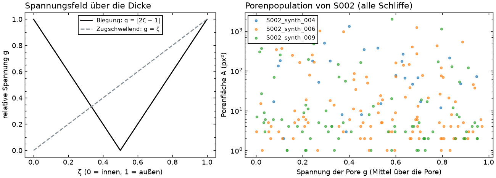
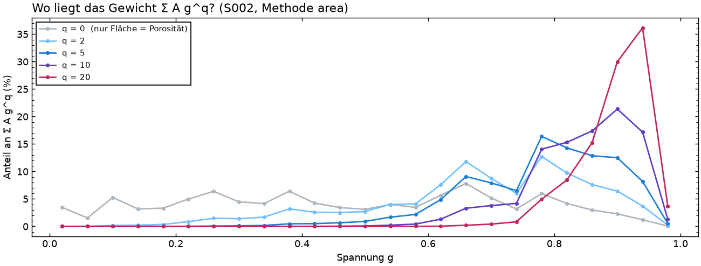
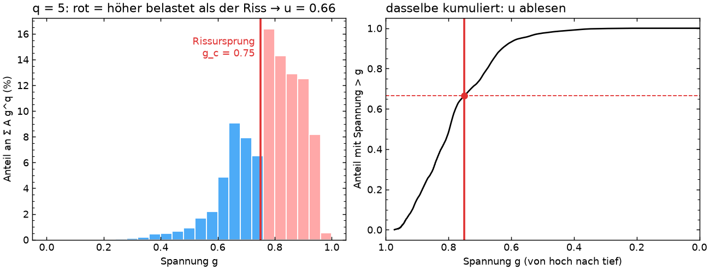
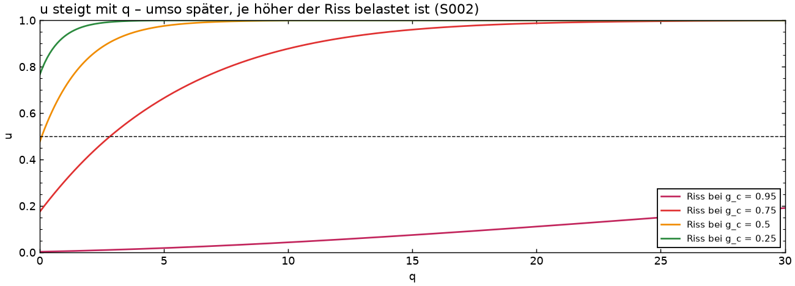
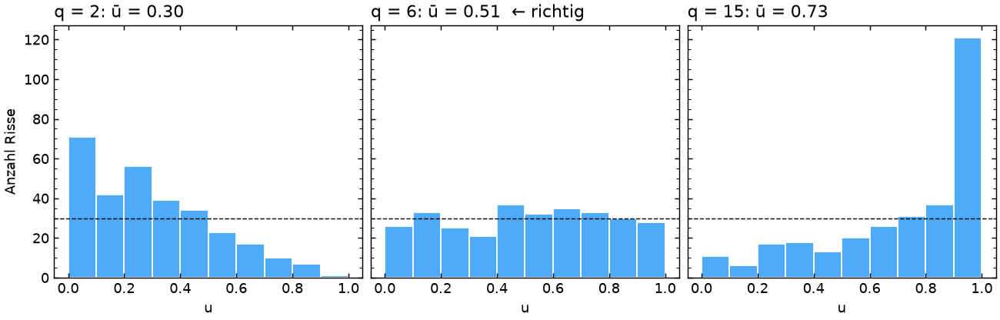
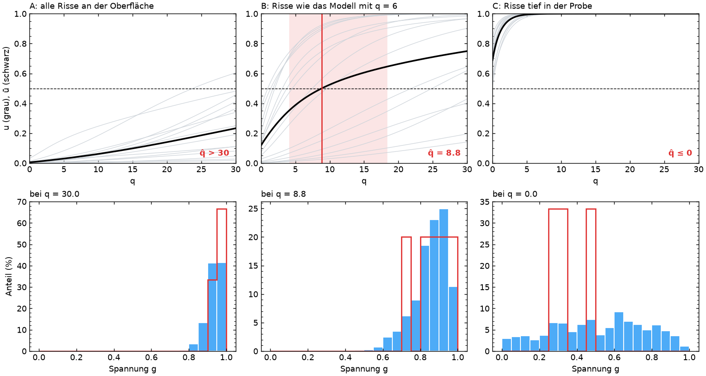
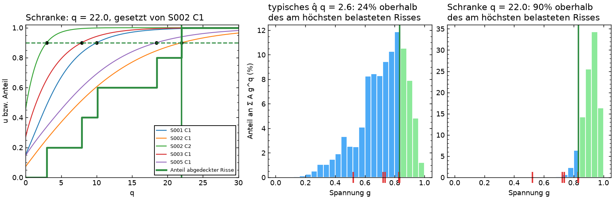
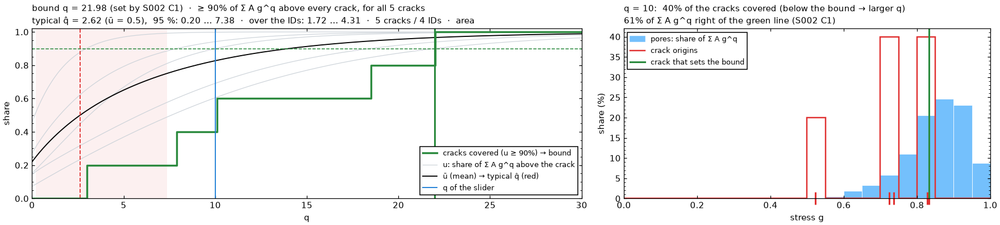
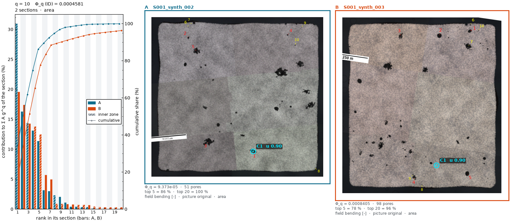
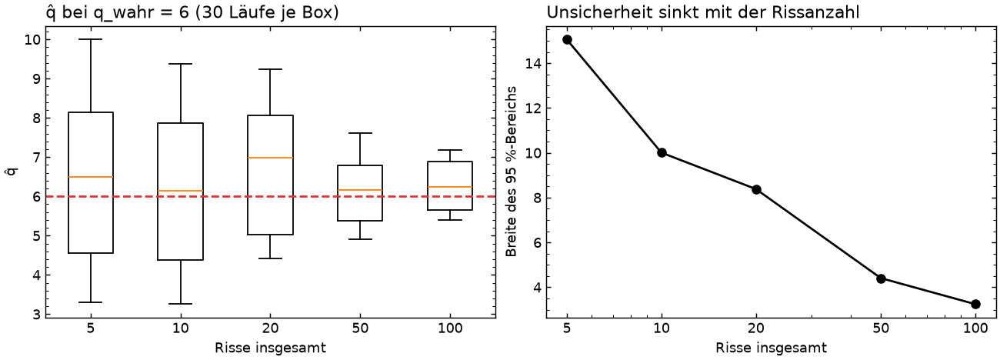

# q aus den Rissursprüngen fitten – anschaulich erklärt

Diese Datei erklärt Schritt für Schritt und mit Bildern, wie der q fitter **ein** q für alle IDs aus
den gelabelten Rissen bestimmt, wie man die Plots im Programm liest und was daraus folgt. Die
Formeln stehen kompakt in [Q_FIT.md](Q_FIT.md), die Porenspannungs-Methoden in
[PORENSPANNUNG.md](PORENSPANNUNG.md).

Es gibt zwei Ergebnisse, beide aus derselben Zahl u pro Riss (Abschnitt 4):

- **Schranke (Hauptergebnis, Abschnitt 8):** das kleinste q, bei dem die kritischen Poren über den
  Rissursprüngen liegen.
- **Typisches q̂ (Abschnitte 6–7):** das q, bei dem die Rissursprünge im Mittel in der Mitte der
  erwarteten Verteilung liegen.

Die Bilder entstehen mit `.venv\Scripts\python docs\make_figures.py` aus den Testdaten in `input/`
und aus synthetischen Rissen, also Rissen, die aus dem Porenmodell selbst gewürfelt werden und deren
„wahres“ q deshalb bekannt ist.

---

## 1. Die Frage

Der Porenindex gewichtet jede Pore mit ihrer Fläche und ihrer Spannung:

$$
B_i = A_i \cdot g_i^{\,q}
$$

**q legt fest, wie stark die Spannung gegenüber der Fläche zählt.** Bei kleinem q gewinnen große
Poren, egal wo sie liegen. Bei großem q gewinnen Poren an hoch belasteten Stellen, auch kleine.
Welches q ist richtig? Die Risse sagen es uns: Sie sind dort gestartet, wo es für das Material
tatsächlich kritisch war.

Problem: Wir kennen vom Riss nur den **Ort** auf der Bruchfläche, nicht die Größe der Anrisspore.
Außerdem liegen die Schliffe mit den Poren in anderen Ebenen als die Bruchfläche. Eine Pore im
Schliff ist also nie „die“ Anrisspore.

**Lösung:** Wir benutzen vom Riss nur die **Spannung an seinem Ursprung**, und vergleichen sie mit
der **ganzen Porenpopulation** der ID.

---

## 2. Bausteine: Spannungsfeld und Poren

- **Links:** Das Spannungsfeld ordnet jedem Ort eine relative Spannung g zu. Bei Biegung ist sie
  an beiden Oberflächen 1 und in der Mitte 0. Jede Pore und jeder Rissursprung bekommt so eine
  Spannung.
- **Rechts:** Alle Poren der drei Schliffe von S002. Große und kleine Poren gibt es bei allen
  Spannungen. Welche davon „kritisch“ sind, entscheidet erst q.

---

## 3. Was q mit dem Gewicht macht

Gezeigt ist, wie sich das Gesamtgewicht $\sum A g^q$ der ID auf die Spannung verteilt:

- **q = 0** (grau): $g^0 = 1$, es zählt nur die Fläche. Das Gewicht verteilt sich über alle
  Spannungen, so wie die Porosität.
- **q = 5** (blau): Das Gewicht wandert nach rechts, der Schwerpunkt liegt bei g ≈ 0,75–0,9.
- **q = 20** (rot): Fast alles Gewicht liegt bei g > 0,85, also an der Oberfläche.

**Konsequenz:** q verschiebt, wo das Modell die Risse erwartet: von „überall, wo große Poren sind“
(q klein) zu „nur an der höchsten Spannung“ (q groß).

---

## 4. Die Zahl u: wo liegt ein Riss in dieser Verteilung?

Für jeden Riss wird gefragt: **Welcher Anteil des Gewichts $\sum A g^q$ seiner ID ist höher
belastet als sein Ursprung?** Das ist **u**.

Beispiel (q = 5, Riss bei g_c = 0,75): Links ist der rote Teil höher belastet als der Riss. Er
macht 66 % des Gewichts aus, also **u = 0,66**. Rechts ist dasselbe kumuliert dargestellt; dort
liest man u direkt an der roten Linie ab.

Bedeutung von u:
- **u ≈ 0:** Der Riss liegt an der höchstbelasteten Stelle der Population. Fast nichts ist kritischer.
- **u ≈ 1:** Der Riss liegt dort, wo das Modell fast nichts erwartet. Fast alles ist kritischer.
- **u ≈ 0,5:** Der Riss liegt mitten in dem, was das Modell erwartet.

Im Programm steht dieses u an jedem Riss im Bild (z. B. `C1  u 0.90`, siehe Abschnitt 9.2).

---

## 5. u hängt von q ab

Mit wachsendem q wandert das Gewicht zur hohen Spannung (Abschnitt 3). Damit liegt immer mehr
Gewicht **über** einem festen Riss: **u steigt mit q, für jeden Riss.**

- Ein Riss bei mittlerer Spannung (g_c = 0,5, orange) hat schon bei q = 0 u ≈ 0,5. Für ihn passt
  „nur Fläche“.
- Ein Riss bei g_c = 0,75 (rot) erreicht u = 0,5 erst bei q ≈ 3.
- Ein Riss fast an der Oberfläche (g_c = 0,95) bleibt bis q = 30 unter u = 0,2. Er „verlangt“
  ein sehr großes q.

**Konsequenz:** Jeder Riss allein zeigt schon eine Richtung. Hoch belastete Ursprünge ziehen q
nach oben, niedrig belastete nach unten.

---

## 6. Warum gerade 0,5? Die Gleichverteilung

Hier wurden 300 Risse aus dem Modell mit dem wahren **q = 6** gewürfelt. Dargestellt ist die
Verteilung ihrer u-Werte bei drei q:

- **Beim richtigen q (Mitte)** sind die u **gleichverteilt**: Jeder Bereich von 0 bis 1 ist
  gleich oft besetzt (gestrichelte Linie), und der Mittelwert ist **ū = 0,51**. Das ist kein
  Zufall: Wenn die Risse genau so entstehen, wie das Modell es sagt, ist u eine gleichverteilte
  Zufallszahl.
- **Bei zu kleinem q (links, q = 2)** häufen sich die u bei 0, und ū = 0,30. Die Risse liegen
  höher belastet, als das Modell erwartet.
- **Bei zu großem q (rechts, q = 15)** häufen sich die u bei 1, und ū = 0,73. Die Risse liegen
  tiefer, als das Modell erwartet.

**Daraus folgt die Fit-Regel:** **q̂ ist das q, bei dem der Mittelwert ū = 0,5 ist.** Weil jedes u
mit q steigt, gibt es genau ein solches q. Für diese 300 Risse liefert der Fit
**q̂ = 5,75 (95 %: 4,97 … 6,62)** und trifft das wahre q = 6.

> **Wichtig: q̂ ist keine Untergrenze.** Es ist das q, bei dem die Rissursprünge *im Mittel* in der
> Mitte der erwarteten Verteilung liegen. Ein einzelner tiefer Anriss zieht q etwas nach unten,
> macht seine Tiefe aber nicht zum Gipfel der Verteilung.

---

## 7. Drei typische Fälle

Oben steht jeweils u jedes Risses (grau), ihr Mittel ū (schwarz) und q̂ (rot, mit 95 %-Bereich).
Unten ist die Verteilung des Gewichts bei q̂ zu sehen (blau) und darüber die Rissursprünge (rot).
Je 3 Risse in jeder der 5 IDs:

| Fall | Was man sieht | Ergebnis | Bedeutung |
|---|---|---|---|
| **A: alle Risse an der Oberfläche** (g ≈ 0,95–0,98) | ū bleibt bis q = 30 unter 0,5. Selbst dann liegt das Gewicht nicht so weit außen wie die Risse. | **q̂ > 30** | Die Risse starten so konsequent an der höchsten Spannung, dass die Porengröße praktisch keine Rolle spielt. Entweder ist q sehr groß, oder die Risse starten nicht an Poren (z. B. Oberflächenrauheit). |
| **B: Risse wie das Modell mit q = 6** | ū schneidet 0,5 sauber. Die roten Rissbalken liegen über der blauen Masse verteilt. | **q̂ = 8,8 (95 %: 4,1 … 18,4)** | Das Modell passt. Mit 15 Rissen ist q aber nur grob bestimmt; das wahre q = 6 liegt im Bereich. |
| **C: Risse tief in der Probe** (g ≈ 0,3–0,45) | ū liegt schon bei q = 0 über 0,5. | **q̂ ≤ 0** | Die Risse starten tiefer, als selbst „nur Fläche“ erwartet. Die Spannung erklärt den Anriss nicht; zu prüfen sind die Spannungsannahme, das Spannungsfeld und Ausreißer. |

**Konsequenz:** Steht q̂ an einem Rand des Schiebereglers („> max“ oder „≤ min“), ist das kein
Zahlenwert, sondern ein Hinweis, dass das Modell $A g^q$ die Rissorte so nicht beschreibt.

---

## 8. Die Schranke: die kritischen Poren über den Anrissen (Hauptergebnis)

Das typische q̂ beantwortet „bei welchem q sind die Anrisse *typisch*?“. Oft will man aber etwas
anderes: **Der Porenindex soll von den Poren bestimmt werden, die mindestens so hoch belastet sind
wie die Stellen, an denen Risse tatsächlich gestartet sind.** Poren in Bereichen, in denen kein Riss
startete, sollen wenig beitragen.

Dafür reicht wieder u: u ist genau der Anteil von $\sum A g^q$ oberhalb der Spannung am Anriss. Die
Forderung „mindestens 90 % des Porenindex kommen von Poren über diesem Anriss“ heißt also
**u ≥ 0,9**.

**Links:** Jede farbige Linie ist u eines Risses über q. Wo sie die gestrichelte 90 %-Linie schneidet
(schwarzer Punkt), ist dieser Riss „abgedeckt“. Die grüne Treppe zählt, wie viele Risse bei diesem
q schon abgedeckt sind. **Die Schranke ist das q, bei dem die Treppe 100 % erreicht**, hier
**q = 22,0**. Gesetzt wird sie vom Riss S002 C1, dem am höchsten belasteten (g = 0,83): Er braucht
am längsten, bis 90 % des Gewichts über ihm liegen.

**Mitte und rechts:** die Verteilung von $\sum A g^q$ über der Spannung, grün der Teil oberhalb dieses
Risses. Beim typischen q̂ = 2,6 sind das nur 24 %: Der Index kommt dann zu drei Vierteln von Poren,
die *niedriger* belastet sind als dieser Anriss. Bei der Schranke q = 22 sind es 90 %.

**Warum „das kleinste q“?** Mit größerem q wandert das Gewicht immer weiter zur höchsten Spannung.
„Möglichst viele kritische Poren über den Anrissen“ wird also mit jedem größeren q erfüllt, bis zum
Extrem, in dem eine einzige Pore an der Oberfläche den Index allein bestimmt. Die Schranke ist das
q, ab dem die Forderung **gerade erfüllt** ist, und damit das kleinste q, das die Risse noch
respektiert, ohne die Fläche der Poren unnötig zu entwerten.

**Einstellungen** (`config.yaml` → `fit.bound`):

| Einstellung | Bedeutung | Wirkung |
|---|---|---|
| `share: 0.9` | Anteil von $\sum A g^q$, der über dem Anriss liegen muss | größer → größere Schranke |
| `reference: every_crack` | über **jedem** Anriss; der am höchsten belastete setzt die Schranke | streng |
| `reference: lowest_crack_per_id` | über dem **niedrigsten** Anriss jeder Probe: „alles, was mindestens so hoch belastet ist wie dort, wo in dieser Probe schon ein Riss startete“ | milder (Testdaten: 18,4 statt 22,0) |
| `cracks: 1.0` | Anteil der Risse bzw. IDs, die abgedeckt sein müssen | < 1 lässt Ausreißer an der Oberfläche außen vor (Testdaten, 80 %: 18,4) |

**Was man wissen muss:**
- Die Schranke hängt an **einem** Riss. Sie hat kein statistisches Intervall, und neue Risse können
  sie nur erhöhen (bei `cracks: 1.0`).
- Ein Anriss in der Mitte (niedrige Spannung) stört **nicht**: Über ihm liegt ohnehin fast alles.
- Ein Anriss genau an der höchsten Spannung der Probe wird **nie** abgedeckt; dann steht
  „bound q > q max“. Mit `cracks` < 1 bleibt er außen vor.
- Die Schranke ist ein **oberes** Ende, q̂ ein typischer Wert. Liegen beide weit auseinander (hier
  2,6 und 22), streuen die Anrisse stark über die Spannung.

---

## 9. Die Plots im Programm

### 9.1 Das Panel „Fit q“

Das Bild zeigt die Testdaten (5 Risse in 4 IDs, Methode `area`), mit dem Schieberegler bei q = 10.

**Links: über q**

| Element | Bedeutung |
|---|---|
| **grüne Treppe** | Anteil der Risse, die abgedeckt sind (u ≥ 90 %) |
| grün gestrichelt | der geforderte Anteil `share` |
| **grüne Linie** | **die Schranke** (hier 21,98) |
| graue Linien | u jedes einzelnen Risses |
| schwarze Linie | ū, der Mittelwert über alle Risse |
| rot gestrichelt, rot schattiert | **typisches q̂** (ū = 0,5, hier 2,62) und sein 95 %-Bereich (0,20 … 7,38) |
| blaue Linie | das q des Schiebereglers |
| Titel | Zeile 1: Schranke, welcher Riss sie setzt, Einstellungen. Zeile 2: q̂, 95 %-Bereich, „over the IDs“ (Streuung, wenn man IDs weglässt oder doppelt nimmt), Anzahl Risse/IDs, Methode |

**Rechts: Spannungsverteilung beim q des Schiebereglers**

| Element | Bedeutung |
|---|---|
| blaue Balken | Anteil von $\sum A g^q$ je Spannungsbereich, alle IDs mit Rissen zusammen |
| rote Treppe und Striche | Anteil der Rissursprünge je Spannungsbereich, Striche = einzelne Risse |
| grüne Linie | Spannung des Risses, der die Schranke setzt |
| Titel | wie viele Risse bei diesem q abgedeckt sind, und wie viel von $\sum A g^q$ rechts der grünen Linie liegt |

Hier bei q = 10: 40 % der Risse sind abgedeckt, und rechts der grünen Linie liegen erst 61 %. Der
Titel sagt „below the bound → larger q“. Die Knöpfe:
- **„q → bound“** setzt den Schieberegler auf die Schranke, auf den Schritt aufgerundet, damit sie
  sicher erreicht ist.
- **„q → q̂“** setzt ihn auf das typische q.

### 9.2 u am Riss im Bild

An jedem Riss steht sein u beim aktuellen q. Bei S001 (q = 10) liegt C1 in Schliff A **direkt an
Pore Nr. 1** von A und hat trotzdem **u = 0,90**. Wie passt das zusammen?

- Das Pareto und die Nummern gelten **je Schliff**. Pore 1 ist die kritischste Pore von A.
- u vergleicht mit der **ganzen ID**. Schliff B trägt 90 % des Gewichts der ID, bei höherer
  Spannung als C1.
- Der Fit fragt nicht „liegt der Riss an einer roten Pore?“, sondern „ist die Spannung am Ursprung
  typisch für das Porengewicht der ganzen Probe?“. Bei q = 10 ist sie es nicht, sie ist zu niedrig.
  Deshalb wird q kleiner.

---

## 10. Wie viele Risse braucht man?

Synthetische Risse mit dem wahren q = 6, verteilt auf die 5 IDs der Testdaten, je 30 Wiederholungen:

| Risse insgesamt | 5 | 10 | 20 | 50 | 100 |
|---|---|---|---|---|---|
| Breite des 95 %-Bereichs | 15,1 | 10,0 | 8,4 | 4,4 | 3,2 |

- **Links:** q̂ trifft im Mittel das wahre q. Mit wenigen Rissen streut es aber stark (Boxen: 10–90 %).
- **Rechts:** Mit **5–10 Rissen** weiß man nur grob, ob q eher bei 2 oder bei 15 liegt. Für einen
  Bereich von etwa ±2 braucht man **um die 50 Risse**.

**Konsequenz:** Erst ab einigen Dutzend Rissen lohnt es sich, Methoden (area, centroid, max, mean)
anhand von q̂ zu vergleichen; vorher überlappen ihre Bereiche fast immer.

---

## 11. Plots lesen: Beobachtung → Bedeutung → was tun

| Beobachtung | Bedeutung | Was tun |
|---|---|---|
| Die grüne Treppe springt erst ganz rechts auf 100 %, gesetzt von einem einzelnen Riss | Ein oberflächennaher Riss bestimmt die Schranke allein | Diesen Riss prüfen (Rissort, Rahmen, `GEOMETRIE.md`); ist er echt, mit `fit.bound.cracks` < 1 als Ausreißer zulassen und beide Werte angeben |
| „bound q > q max“ | Mindestens ein Riss liegt so hoch belastet, dass nie genug Gewicht darüber liegt | Wie oben; ggf. `q.max` erhöhen oder `share` senken |
| Schranke und q̂ liegen nah beieinander | Die Anrisse liegen alle bei ähnlicher, hoher Spannung | Gutes Zeichen: das Modell beschreibt die Anrisse eindeutig |
| Schranke ≫ q̂ (Testdaten: 22 gegen 2,6) | Die Anrisse streuen stark über die Spannung | Für den Index die Schranke nehmen, wenn die hoch belasteten Anrisse maßgeblich sein sollen; den Abstand als Unsicherheit der Modellwahl angeben |
| Die Riss-Beschriftung im Bild ist grün | Dieser Riss ist beim aktuellen q abgedeckt (u ≥ `share`) | – |
| ū schneidet 0,5 in der Mitte, die roten Striche liegen über der blauen Masse verteilt | Modell passt, q̂ ist ein sinnvoller Wert | q̂ übernehmen („q → q̂“), den 95 %-Bereich mit angeben |
| 95 %-Bereich sehr breit (z. B. 0,2 … 7,4) | Zu wenige Risse | Mehr Risse labeln (Abschnitt 10); q̂ nur als Tendenz lesen |
| „q̂ > max“: Risse ganz rechts, rechts von der blauen Masse | Risse starten an der höchsten Spannung, stärker als jedes q erklärt | Prüfen, ob die Risse an Poren starten (Oberfläche, Bearbeitung?); ggf. `q.max` erhöhen |
| „q̂ ≤ min“: Risse links von der blauen Masse | Risse starten tiefer, als selbst die Fläche allein erklärt | Spannungsfeld der IDs prüfen, Rissorte im Labeler prüfen, Ausreißer suchen |
| Graue u-Linien weit gespreizt: einige Risse kreuzen 0,5 bei q ≈ 1, andere bei q ≈ 20 | Die Risse widersprechen sich, ein gemeinsames q passt schlecht | Einzelne Risse und IDs ansehen (u am Riss im Bild); nach Spannungsfeld oder Charge trennen |
| „over the IDs“ deutlich anders als der 95 %-Bereich | Das Ergebnis hängt an einzelnen IDs | Die ID mit den extremen u finden (Bild), prüfen, ob sie anders ist |
| Ein Riss mit u nahe 1 | Er liegt dort, wo das Modell fast keinen Anriss erwartet | Rissort und Spannung prüfen; ein einzelner solcher Riss senkt q̂ spürbar |
| q̂ hängt von der Methode ab (Testdaten: `area` 2,6, `centroid`/`mean` 2,8, `max` 1,6) | `max` gibt der ganzen Porenfläche schon die Spitzenspannung; dann braucht es oft weniger q, um die Risse zu erklären | Die Methode bewusst wählen ([PORENSPANNUNG.md](PORENSPANNUNG.md)); Unterschiede erst ernst nehmen, wenn die 95 %-Bereiche sich nicht mehr überlappen |

---

## 12. Was der Fit nicht kann

- Er sieht **nicht**, ob ein Riss an einer bestimmten Pore liegt. Er vergleicht nur die Spannung
  am Ursprung mit der **Population** der Poren. Die Schliffe müssen daher für die Probe
  repräsentativ sein.
- Er nimmt **ein q für alle IDs** an. Verhalten sich Proben verschieden (andere Last, andere
  Herstellung), zeigt sich das als breite Streuung der u-Linien und als Abweichung des Bereichs
  „over the IDs“.
- Er braucht **das richtige Spannungsfeld**. g am Rissursprung wird mit demselben Feld berechnet wie
  bei den Poren; stimmt das Feld nicht, stimmt q̂ auch nicht.
- Mit wenigen Rissen gibt er eine **Tendenz**, keinen genauen Wert. Der 95 %-Bereich sagt ehrlich,
  wie grob.
